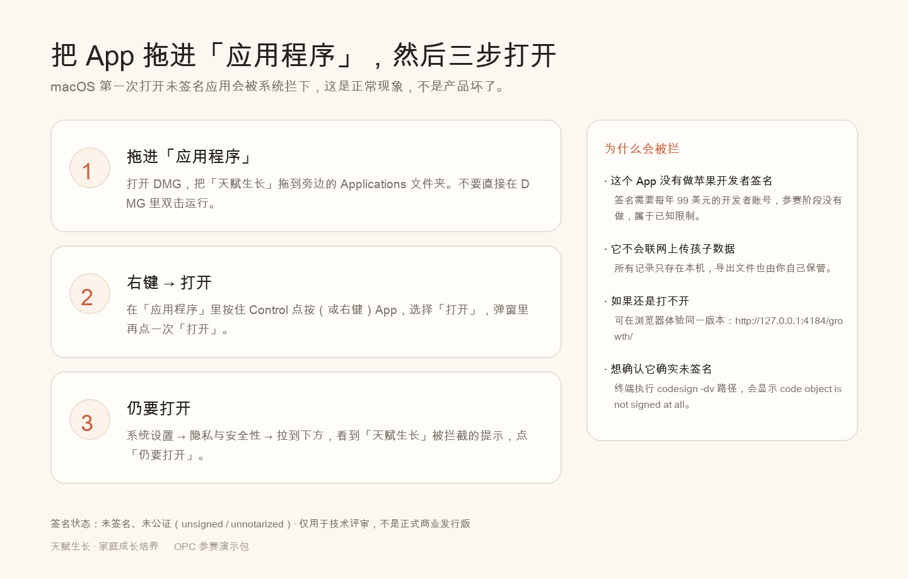

# DMG 首次打开指引



macOS 第一次打开**未签名**应用会被系统拦下。这是系统安全策略，不是产品坏了。

## 三步

### 第一步：拖进「应用程序」

打开 DMG，把「天赋生长」拖到旁边的 `Applications` 文件夹。

> 不要直接在 DMG 里双击运行——那样每次都要重新挂载，而且部分系统会直接拒绝。

### 第二步：右键 → 打开

在「应用程序」里找到「天赋生长」，**按住 Control 点按**（或右键），选择「打开」。

弹窗里仍会提示「无法验证开发者」，这时**再点一次「打开」**即可。系统会记住这次授权，之后双击就能正常启动。

### 第三步：还不行，去设置里放行

如果第二步没有出现「打开」按钮：

```text
系统设置 → 隐私与安全性 → 拉到下方
看到「天赋生长」被阻止的提示 → 点「仍要打开」
```

## 常见问题

| 现象 | 原因 | 处理 |
| --- | --- | --- |
| 提示「已损坏，应移到废纸篓」 | 下载过程带了隔离属性 | 终端执行 `xattr -dr com.apple.quarantine /Applications/天赋生长.app` |
| 双击后闪一下就消失 | 被 Gatekeeper 静默拦截 | 用第二步的右键打开 |
| 提示「无法验证开发者」 | 未签名、未公证 | 第二步的「打开」或第三步的「仍要打开」 |
| 打不开也不想折腾 | — | 直接用浏览器打开 Web 版：`http://127.0.0.1:4184/growth/` |

## 为什么没有签名

```text
签名需要 Apple Developer 账号（99 美元/年）+ 公证流程。
参赛阶段没有做，这是已知限制，不是技术故障。

可以用下面的命令自行确认：
  codesign -dv --verbose=2 /Applications/天赋生长.app
  → code object is not signed at all
```

## 这个 App 会不会联网上传数据

不会。所有记录只保存在本机（localStorage + IndexedDB），导出文件由家长自己保管。演示支付页也不会发起任何网络请求。

## 验证信息

| 项目 | 内容 |
| --- | --- |
| 当前版本 | 0.7.6 |
| 架构 | arm64（Apple Silicon） |
| 签名状态 | 未签名、未公证 |
| 系统要求 | macOS 11 及以上 |

SHA-256 与版本号见 `desktop/tauri/release/SHA256SUMS-*.txt`。
