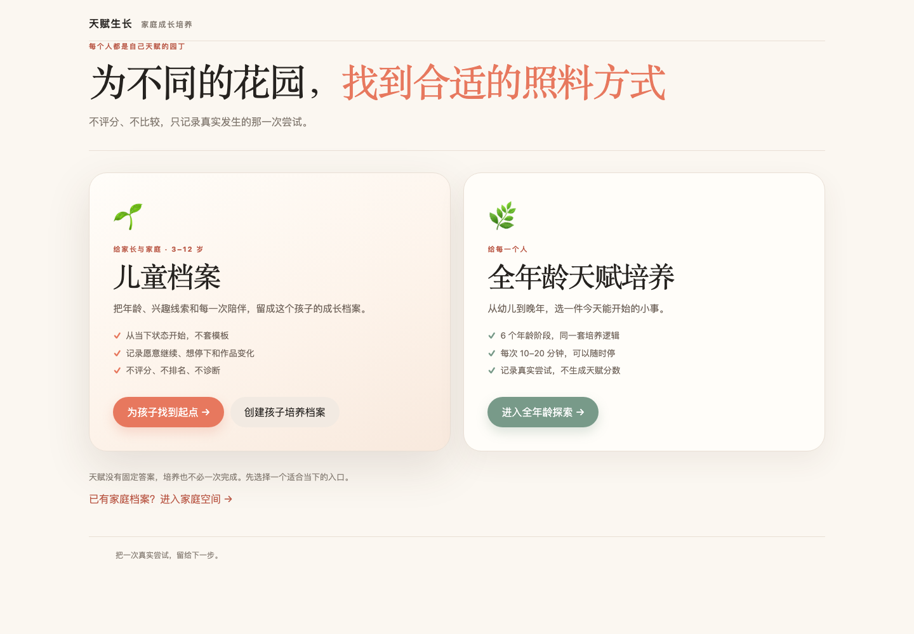

# 首页设计说明（已定稿）

首页以此版为基准，后续改动需先对齐这份说明。



## 一、结构与尺寸

```text
页头    天赋生长  家庭成长培养
        ─────────────────────────────
标题区  每个人都是自己天赋的园丁（kicker）
        为不同的花园，找到合适的照料方式（h1，单行）
        不评分、不比较，只记录真实发生的那一次尝试。（副标题，单行）

        横线（1px，通栏 1160px）
        ─────────────────────────────

双入口  ┌────────────┬────────────┐
        │ 儿童档案    │ 全年龄天赋培养│
        └────────────┴────────────┘

尾部    天赋没有固定答案，培养也不必一次完成。先选择一个适合当下的入口。
        已有家庭档案？进入家庭空间 →
```

在 1280 宽视口下实测：

| 元素 | 位置与尺寸 |
| --- | --- |
| 容器 `.tg-shell` | x=60，宽 1160 |
| 大标题 | 单行，宽 980 内一行放下 |
| 横线 | y=236，通栏 1160 |
| 左卡片「儿童档案」 | x=60，570×425 |
| 右卡片「全年龄天赋培养」 | x=650，570×425 |

## 二、两个入口的分工

| | 儿童档案（左） | 全年龄天赋培养（右） |
| --- | --- | --- |
| 面向 | 家长，3–12 岁孩子家庭 | 每一个人，6 个年龄阶段 |
| 视觉 | 暖色渐变底 + 强阴影，主推位 | 白底、鼠尾草绿点缀，并列位 |
| 主按钮 | 为孩子找到起点 →（珊瑚色） | 进入全年龄探索 →（绿色） |
| 次按钮 | 创建孩子培养档案 | 无 |
| 要点 | 从当下状态开始／记录愿意继续与停下／不评分不排名不诊断 | 6 个年龄阶段／每次 10–20 分钟／不生成天赋分数 |

## 三、排版规则（必须保持）

1. **容器不被旧样式收窄**：`.tg-shell main`、`.tg-app main` 必须复位为 `max-width: none`。旧儿童模块的全局 `main { max-width: 680px }` 会把首页压成窄栏，是最容易复发的坑。
2. **标题均衡**：`h1/h2/h3` 使用 `text-wrap: balance`，两行时长度接近。
3. **正文不留孤字**：`p/li/dd/b/strong/small/span/em/label/summary` 使用 `text-wrap: pretty`，避免末行只剩一两个字。
4. **短标签不换行**：品牌、导航、按钮、入口按钮使用 `white-space: nowrap`。
5. **文案按一行可放下来写**：副标题与两张卡片的说明都控制在一行内，写完用真实浏览器量一遍。
6. **中文本地规则**：`line-break: strict`、`word-break: normal`，不使用 `overflow-wrap: anywhere` 处理中文段落。

## 四、验证方式

改动首页后，用真实浏览器（不是肉眼猜）检查：

- 在 1440 / 1280 / 1100 / 1000 / 900 / 700 六个宽度下，遍历文本节点，检查是否出现“折行后末行只剩 1–2 个字”；
- 检查两条主路径都能进入：`data-action="open-parent-growth"` 与 `data-action="open-all-growth"`；
- 检查 `data-action="open-profile"`（创建孩子培养档案）与 `data-action="open-family-space"`（家庭空间）可达；
- 运行 `node --test 'talent-growth/app/tests/*.test.mjs'`，保持全部通过。

## 五、相关实现位置

- 结构：`talent-growth/app/www/main.js` → `renderLanding()`
- 样式：`talent-growth/app/www/talent.css` → `.tg-landing-*`、`.tg-entry-*`、排版规则块
- 入口动作：`main.js` 中 `open-parent-growth`、`open-all-growth`、`open-profile`、`open-family-space`
